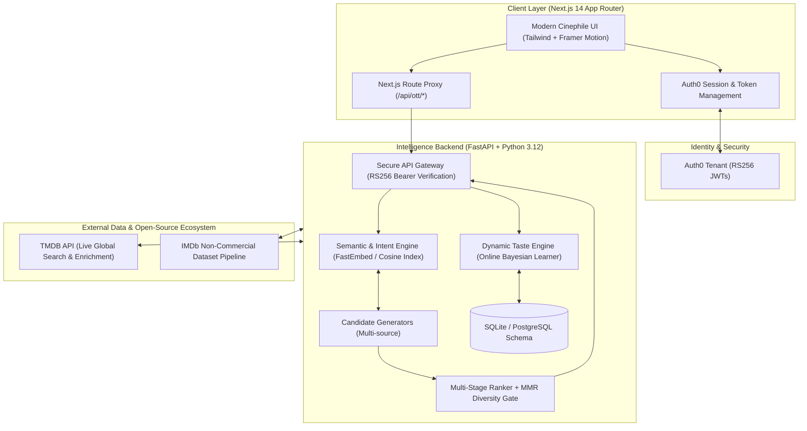

# 🎬 OTT Intelligence Platform

> **Next-Generation Cognitive Taste Engine, Global Entertainment Discovery & Psychological Recommender System**

[](https://ott-intelligence-web.vercel.app)
[](https://nextjs.org/)
[](https://fastapi.tiangolo.com/)
[](https://python.org/)
[](https://www.typescriptlang.org/)
[](https://auth0.com/)
[](LICENSE)

---

## 🌐 Live Application
- **Production Web Application:** [https://ott-intelligence-web.vercel.app](https://ott-intelligence-web.vercel.app)

---

## 1. 💡 Why This Platform Exists: The Problem with Modern Streaming

Modern streaming platforms are suffering from **algorithmic stagnation and popularity monoculture**:
1. **Generic Popularity Carousels:** Traditional recommender engines rely on shallow collaborative filtering (*"Users who watched X also watched Y"*), resulting in identical, repetitive recommendations driven strictly by marketing priority and mass view counts rather than genuine emotional fit.
2. **Context & Mood Blindness:** A user who loves high-tension cerebral sci-fi on Friday night might be exhausted on Tuesday evening and need low-cognitive-load wholesome comfort. Standard engines treat taste as static.
3. **The Black Box Dilemma:** Recommendations are thrown at users without explanation or evidence, causing endless "scroll fatigue" and decision paralysis.
4. **Catalog Trapping:** Obscure masterpieces, regional Indian cinema gems, and international auteurs (Korean, Japanese, French, European) are drowned out by whatever is currently trending in Hollywood.

### The Paradigm Shift
The **OTT Intelligence Platform** replaces superficial tagging with **Preference & Cognitive Intelligence**. Instead of asking *"What movie is mathematically adjacent to this title?"*, it answers:

> *"Given everything this specific individual has watched, completed, liked, re-watched, abandoned, and felt across different emotional mindsets, what is the exact narrative complexity, pacing, and emotional payoff they crave right now—and why?"*

---

## 2. 🏛️ System Architecture



---

## 3. 🎯 Key Capabilities & Signature User Experiences

### 🎟️ 1. Real-Time Marquee & Mood Studio
- **Dynamic Emotional Atmospheres:** 7 distinct psychological states (`comforting`, `emotional`, `reflective`, `mystery`, `exciting`, `romance`, `strange`).
- **Ambient Lighting:** Selecting a mood re-lights the entire user interface and dynamically recalculates taste weightings in real time.
- **Isolated Mood Memories:** The platform learns what genres, paces, and narrative styles you reach for *in each specific mood*. Your "mystery" taste doesn't contaminate your "comforting" taste.

### 🧭 2. "Find My Watch" Dynamic Discovery Cockpit
- **Natural Language Constraint Engine:** Accepts free-form prompts (*"I have 90 minutes. I want an intense mystery with phenomenal cinematography, non-American"*).
- **Interactive Multi-Axis Sliders:** Runtime constraints, mood weighting, narrative complexity sliders, and familiarity vs. adventure threshold.
- **"Your Perfect Window" Telemetry Meters:** Real-time analytics displaying:
  - `Emotional Depth` (0–100%)
  - `Mystery Level` (0–100%)
  - `Narrative Complexity` (0–100%)
  - `Visual Atmosphere` (0–100%)
  - `Novelty Quotient` (0–100%)
- **Contrastive "Why This One?" Reasoning:** Transparent explanations articulating why the hero pick was selected over alternatives.

### 🔍 3. Hybrid Semantic & Live Global Cinema Search
- **Two-Tier Engine:** First scans the local psychological feature space, then dynamically queries the **TMDB global database** for any searched movie worldwide.
- **Instant Global Catalog Access:** Whether searching for all-time Indian classics (*Sholay*, *Dilwale Dulhania Le Jayenge*), Japanese anime (*Spirited Away*), or Hollywood epics (*Harry Potter*, *Interstellar*), the engine dynamically ingests, maps, and ranks the title with personal match scores.

### 🎭 4. Actor, Director & Character-Vibe Discovery
- **Actor & Director Spotlights:** Discover films curated by auteur or star.
- **Character Psychological Resonance:** Find films featuring similar character archetypes and psychological undertones.

### 🌌 5. The Taste Universe
- **Interactive Constellation Radar:** Visualizes your taste topology across genre frontiers, auteur affinities, and narrative preferences.
- **Frontier Exploration:** Identifies blind spots and adjacent clusters outside your comfort zone that have high psychological alignment.

### 🎬 6. "Why Should I Watch This?" Inspector Modal
- **Personal Match %:** Accurate Bayesian alignment score derived from your active taste vector.
- **Side-by-Side Taste Mapping:** Visual comparison of *Your Taste* $\rightarrow$ *Movie Profile*.
- **Verified Review Provenance:** Categorized review excerpts highlighting emotional impact, pacing, and visual atmosphere.
- **Streaming Availability:** Live flatrate streaming provider badges (Netflix, Prime Video, Disney+, Apple TV+, etc.).
- **Live Calibration Feedback:** Buttons for `Watch Now`, `Save`, `Not For Me`, and `Abandoned` instantly update your preference vector.

---

## 4. 🧠 Machine Learning & Intelligence Pipeline

```
Raw Content Ingestion ➡️ 20-D Emotional & Narrative Profiling ➡️ Dynamic Vector Synthesis
                                                                           ⬇️
Explanation & Feedback ⬅️ Multi-Stage Ranking & MMR ⬅️ Multi-Strategy Candidate Retrieval
```

### Phase 1: Ingestion & Quality Calibration
To prevent low-vote niche titles from artificially dominating rankings, all items are weighted using an **IMDb-style Bayesian Mean Calculation**:

$$W = \frac{v}{v + m} \cdot R + \frac{m}{v + m} \cdot C$$

- $v$: Total vote count for the title
- $m$: Minimum vote threshold (e.g., $1,000$ votes)
- $R$: Average user rating
- $C$: Mean rating across the entire cinema corpus ($7.5$)

### Phase 2: 20-Dimensional Emotional & Narrative Profiling
Every title is mapped into an extensive psychological and narrative feature space:
- **20 Emotion Spectra:** `AWE`, `WONDER`, `JOY`, `COMFORT`, `NOSTALGIA`, `TENSION`, `SUSPENSE`, `FEAR`, `ANXIETY`, `SADNESS`, `GRIEF`, `HOPE`, `INSPIRATION`, `ROMANCE`, `CURIOSITY`, `CONFUSION`, `FRUSTRATION`, `SATISFACTION`, `REFLECTION`, `MOTIVATION`.
- **Narrative Complexity:** Character-driven vs. plot-driven index, philosophical depth score, and non-linear storytelling rating.
- **Pacing Index:** Quantitative measure of narrative velocity (`slow_burn`, `medium`, `kinetic`).

### Phase 3: Online Continual Taste Vector Learning
As users interact with content, their persistent `UserTasteVector` updates via decay-weighted online learning:

$$\vec{T}_{t+1} = \alpha \cdot \vec{T}_t + (1 - \alpha) \cdot w_{\text{event}} \cdot \vec{C}_{\text{item}}$$

| User Action | Weight ($w_{\text{event}}$) | Psychological Impact |
|---|:---:|---|
| `REWATCH` | **+1.4** | Strongest signal of lifelong taste alignment |
| `WATCH_COMPLETE` | **+1.0** | Confirms narrative pacing and thematic payoff |
| `LIKE` | **+0.9** | Immediate positive aesthetic resonance |
| `SAVE` | **+0.7** | Aspirational taste intent |
| `ABANDON` | **-0.7** | Flags negative pacing or unappealing opening tropes |
| `DISLIKE` | **-1.3** | Strong negative penalty against similar themes |

### Phase 4: Multi-Stage Candidate Generation & MMR Diversification
1. **Candidate Retrieval:** Blends semantic intent embeddings, mood-gated catalogs, graph neighborhood traversal, and cross-cultural discovery seeds.
2. **Scoring Formulation:**
   $$\text{Score} = w_{\text{taste}} \cdot S_{\text{taste}} + w_{\text{intent}} \cdot S_{\text{intent}} + w_{\text{quality}} \cdot S_{\text{quality}} + w_{\text{novelty}} \cdot S_{\text{novelty}}$$
3. **Maximal Marginal Relevance (MMR):** Applies diversity penalties to prevent genre or regional monoculture:
   $$\text{MMR} = \arg\max_{D_i \in R \setminus S} \left[ \lambda \cdot \text{Sim}_1(D_i, Q) - (1 - \lambda) \max_{D_j \in S} \text{Sim}_2(D_i, D_j) \right]$$

---

## 5. 🛠️ Tech Stack Specification

### Frontend
- **Framework:** Next.js 14 (App Router, Server Components & Dynamic Route Handlers)
- **UI & Styling:** Tailwind CSS, Custom Cinephile Theme (Obsidian, Amber Gel, Ivory)
- **Animations:** Framer Motion (page transitions, mood dimmer slider, constellation canvas)
- **Icons:** Lucide React
- **Language:** TypeScript 5.6 (Strict Type Checking)
- **Hosting:** Vercel

### Backend
- **Framework:** FastAPI (Asynchronous Python 3.12 Web Framework)
- **Validation & Serialization:** Pydantic v2
- **Server:** Uvicorn (ASGI)
- **Database & ORM:** SQLite / PostgreSQL with SQLAlchemy 2.0 & Alembic migrations
- **Vector Indexing:** FastEmbed & NumPy Cosine Similarity Matrix
- **Testing:** Pytest with asynchronous test client and mock RSA signing suites
- **Hosting:** Render

### Security & Authentication
- **Protocol:** Auth0 Universal Login with OAuth 2.0 / OpenID Connect
- **Token Verification:** RS256 Asymmetric JWT validation (verifying `issuer`, `audience`, `signature`, and `expiry`)
- **Server-Side Proxy:** Secure Next.js backend proxy attaching tokens, preventing token leakage in browser environments.

---

## 6. 🚀 Getting Started

### Prerequisites
- Node.js 18+ & npm
- Python 3.12+
- Free Auth0 Account ([https://auth0.com](https://auth0.com))
- Free TMDB API Key ([https://www.themoviedb.org/documentation/api](https://www.themoviedb.org/documentation/api))

---

### Step 1: Clone Repository
```bash
git clone https://github.com/Husain-Taher/OTT-Intelligence-Platform.git
cd OTT-Intelligence-Platform
```

---

### Step 2: Backend Setup (`services/intelligence-core`)
```bash
cd services/intelligence-core

# Create and activate virtual environment
python -m venv .venv
source .venv/bin/activate  # On Windows: .venv\Scripts\activate

# Install dependencies
pip install -r requirements.txt

# Configure environment variables
cp .env.example .env
```

Edit `.env`:
```env
AUTH0_DOMAIN=your-tenant.us.auth0.com
AUTH0_AUDIENCE=https://ott-intelligence-api
TMDB_API_KEY=your_tmdb_api_key
TMDB_READ_TOKEN=your_tmdb_read_access_token
```

Start the FastAPI backend:
```bash
uvicorn app.main:app --port 8000 --reload
```
API Documentation will be live at `http://localhost:8000/docs`.

---

### Step 3: Frontend Setup (`apps/web`)
```bash
cd apps/web

# Install packages
npm install

# Configure environment variables
cp .env.local.example .env.local
```

Edit `.env.local`:
```env
AUTH0_SECRET=generate_with_openssl_rand_-hex_32
AUTH0_BASE_URL=http://localhost:3000
AUTH0_ISSUER_BASE_URL=https://your-tenant.us.auth0.com
AUTH0_CLIENT_ID=your_client_id
AUTH0_CLIENT_SECRET=your_client_secret
AUTH0_AUDIENCE=https://ott-intelligence-api
OTT_API_URL=http://127.0.0.1:8000
```

Start the Next.js development server:
```bash
npm run dev
```
Web application will be live at `http://localhost:3000`.

---

### Step 4: Running Test Suites
```bash
# Backend pytest suite (offline verification, RS256 token tests, mood learning)
$env:PYTHONPATH="services/intelligence-core"; python -m pytest tests/

# Frontend type checking
npm --prefix apps/web run typecheck
```

---

## 7. 🔮 Future Roadmap & Enterprise Scope

- [ ] **Collaborative Watch Parties & Group Preference Solvers:**
  - Multi-user preference fusion computing Pareto-optimal watch choices for couples and groups without compromise fatigue.
- [ ] **Multimodal Trailer Analysis:**
  - Ingestion of trailer audio stems and visual shot-tempo embeddings to model kinetic energy and visual aesthetics.
- [ ] **Automated Scrobbler Integrations:**
  - Webhook synchronization with Letterboxd, Trakt, and Netflix view histories.
- [ ] **Conversational Agentic Recommender:**
  - Full natural language voice dialogue with dynamic counter-factual suggestions.
- [ ] **Postgres + pgvector Production Migration:**
  - Migration from SQLite to scalable distributed vector search utilizing pgvector and HNSW indexing for million-title catalogs.

---

## 8. 📄 License
This project is licensed under the MIT License - see the [LICENSE](LICENSE) file for details.

---

<p align="center">
  Crafted for cinephiles, powered by machine learning and cognitive intelligence.
</p>
